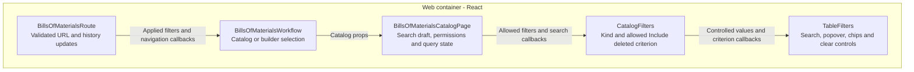
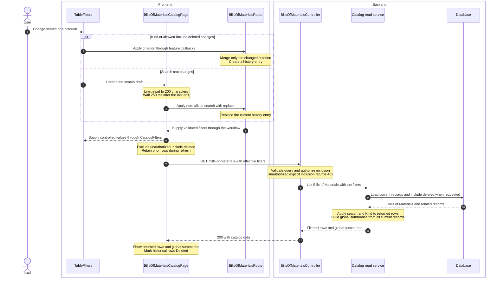

# Bills of Materials Uses Shared Filters and Preserves Global Summaries

The Bills of Materials catalog now uses the shared table-filter control. Users can filter by Kind. Admins can include current and Deleted Bills of Materials in one result set. Filters change the displayed rows; the operational summaries keep their global meaning. This change implements [ticket 04](.scratch/table-filter-standard/issues/04-standardize-bills-of-materials-filters.md) under the [Table Filter Standard](docs/ui/table-filters.md).

## Shared Controls and Clear Actions

[CatalogFilters](apps/web/src/features/bills-of-materials/components/catalog-presentation.tsx) replaces the Kind buttons and separate Include deleted button with the existing shared [TableFilters](apps/web/src/components/app/table-filters.tsx) control. Search stays visible. Kind offers Template and Implementation. Include deleted is available only to Admins and applies directly from the criterion list.

The shared control supplies chip editing, chip removal, immediate selection, popover navigation, close controls, and inline wrapping. It receives allowed criteria and callbacks. It does not interpret roles or build requests. The shared control and its complete interaction test suite do not change.

Clear all clears search and both optional criteria. It restores the default catalog. The popover stays open when the User clears from inside it. When no rows match, CatalogEmptyState directs the User to clear search or filters. It no longer adds a separate clear button.

## URL State, Search, and Browser History

The [Bills of Materials route](apps/web/src/routes/app.bills-of-materials.tsx) owns URL validation and navigation. It maps catalog Kind to `catalogKind`, which stays separate from the builder's `kind` parameter. It uses the existing shared query schema for catalog criteria. Invalid, unsupported, empty, and default catalog values are removed through a canonical URL replacement. Existing builder context fields remain supported.

Search changes replace the current history entry. Criterion selection, editing, removal, and Clear all create history entries. Back and Forward restore the complete applied selection.

The [catalog page](apps/web/src/features/bills-of-materials/bills-of-materials-catalog-page.tsx) synchronizes the search input when the applied URL search changes. It does not subscribe to history events. Scope Boundaries describes the pending-draft limitation.

The catalog page updates the input immediately and limits typed text to 200 characters. It trims the effective search and waits 250 ms before updating the URL and request. This prevents an overlength draft from leaving the updating status active after URL validation rejects it.

The [catalog query hook](apps/web/src/features/bills-of-materials/api/bills-of-materials.ts) retains previous rows while a new filter query loads. The page announces Updating Bills of Materials during the delay or refresh. The query key continues to contain the complete effective filter object.

## Deleted Records and Permission Recovery

Include deleted adds Deleted Bills of Materials to current records. Existing Deleted badges remain beside historical names. Current records receive no additional lifecycle badge.

The catalog page removes unauthorized Include deleted URL state and excludes that flag from the effective request before querying. The [Bills of Materials controller](apps/api/app/modules/bills_of_materials/controllers/bills_of_materials_controller.ts) remains the authorization authority. It now returns `403` when an Operator explicitly requests `includeDeleted=true`. It previously ignored that flag and returned `200`.

The [list endpoint adapter](apps/web/src/features/bills-of-materials/api/endpoints.ts) preserves the HTTP status in ApiRequestError. The catalog page uses that status to distinguish recovery paths:

- A table-level `403` keeps the session, hides the table, and shows a permission message with Clear all.
- Clear all restores the default URL and invalidates the exact default query with `refetchType: 'all'`. This also retries a failed query whose filters already equal the defaults.
- A catalog `401` clears the session and returns the User to sign-in.

## Global Operational Summaries

The [catalog read service](apps/api/app/modules/bills_of_materials/services/read_bills_of_materials.ts) does not change. It builds summaries from all current Bills of Materials, independently of search and Kind restrictions on the returned rows. Deleted records do not contribute to the summaries, even when Include deleted adds them to the table.

Available BOMs, BOMs without an associated Product Variant, and BOMs pending line verification therefore keep their existing meaning. The tests use nonzero summary values to prove this rule across search, Kind, and Include deleted.

## Architecture Views

### C4 Level 3 — Web Filter Composition

Applied values pass down through the rendered components. User actions return through the supplied callbacks. The route owns URL updates, and the catalog page owns the search draft and effective permissions. The page uses the feature query hook and endpoint adapter for requests. These functions are not separate UI components. The shared TableFilters component owns presentation and interaction only.

### C4 Dynamic — Apply Search and Catalog Criteria

This view follows the main feature flow from the shared controls to the returned catalog. CatalogFilters adapts the criteria, and BillsOfMaterialsWorkflow passes props. The sequence omits those two pass-through components. The API path shown below runs when the query fetches data; a fresh cached result can be reused.

The read service and database relationships are existing parts of the list endpoint. The feature connects the shared controls to that path and preserves the global summary calculation. The authorization rejection and Clear all recovery are described under Deleted Records and Permission Recovery; they are secondary flows rather than the main sequence. Domain relationships do not change, so no UML domain view is required.

## Focused Coverage

The [BOM route suite](apps/web/src/routes/-bills-of-materials.test.tsx) proves Kind and Include deleted URL state, canonical defaults, Operator sanitation before requests, mixed current and Deleted rows, chip edits and removal, Clear all, and Back and Forward restoration. It also proves delayed search, retained rows, and the 200-character input limit. Permission cases cover filtered and default-query `403` recovery and separate `401` session expiry. Existing builder and lifecycle scenarios continue to pass.

The [endpoint suite](apps/web/src/features/bills-of-materials/api/endpoints.test.ts) remains part of the focused web verification. The [API catalog suite](apps/api/tests/functional/bills_of_materials/catalog.spec.ts) proves Operator rejection, additive historical inclusion, and global summary invariants under search, Kind, and Include deleted. Feature tests do not repeat the complete shared interaction matrix.

## Focused Verification

The latest web checks below ran from `apps/web` for the current implementation. API verification, independent reviews, and browser checks ran earlier. These diagram updates change documentation only.

- `./node_modules/.bin/vitest run src/routes/-bills-of-materials.test.tsx src/features/bills-of-materials/api/endpoints.test.ts` — 46 tests passed.
- `pnpm --filter @guardiola-foundry/api test --files tests/functional/bills_of_materials/catalog.spec.ts` — 6 tests passed against the local test database.
- `./node_modules/.bin/tsc -b --pretty false` — passed.
- `pnpm --filter @guardiola-foundry/api typecheck` — passed.
- `./node_modules/.bin/oxlint src/routes/app.bills-of-materials.tsx src/routes/-bills-of-materials.test.tsx src/features/bills-of-materials/bills-of-materials-workflow.tsx src/features/bills-of-materials/bills-of-materials-catalog-page.tsx` — passed. Earlier API ESLint checks passed for the controller and catalog tests.
- Earlier independent Standards and Spec reviews identified the search-length and pending-draft cases. The search-length fix is covered by a test. The pending-draft case is outside the current scope.
- Browser checks — confirmed Kind selection, chip behavior, Include deleted with a Deleted row, clearing, URL state, Back and Forward, empty results, and unchanged global summaries. At 390 px, controls wrapped and the page width stayed 390 px. Permission-error recovery was verified through tests; the browser tour did not force an authorization failure.
- Documentation checks — both diagrams passed the Mermaid parser. Local file links, Markdown structure, focused Prettier checks, and `git diff --check` passed.

The sandbox initially blocked the local API listener. The API tests passed with elevated execution. The local browser session also expired during the visual check; the User signed in, and the check continued. Neither condition was a product test failure.

## Scope Boundaries

This ticket changes the Bills of Materials catalog only. It adds no dependencies, migrations, shared domain contracts, or domain relationships. The builder workflows, global summary calculation, and shared filter component keep their existing responsibilities. Other catalog migrations and the combined five-table release review remain outside this ticket; the release review belongs to [ticket 07](.scratch/table-filter-standard/issues/07-verify-and-close-the-unified-filter-migration.md).

If the User types a search and navigates before the 250 ms delay ends, a pending draft can still apply after navigation when both history entries have the same applied search. Cancellation of that draft is outside the current scope. Tests cover restoration of applied URL state with Back and Forward.

The issue retains its completion state and acceptance criteria. This file contains the implementation and verification handoff. The full `pnpm quality` gate was not run, per repository instructions.
