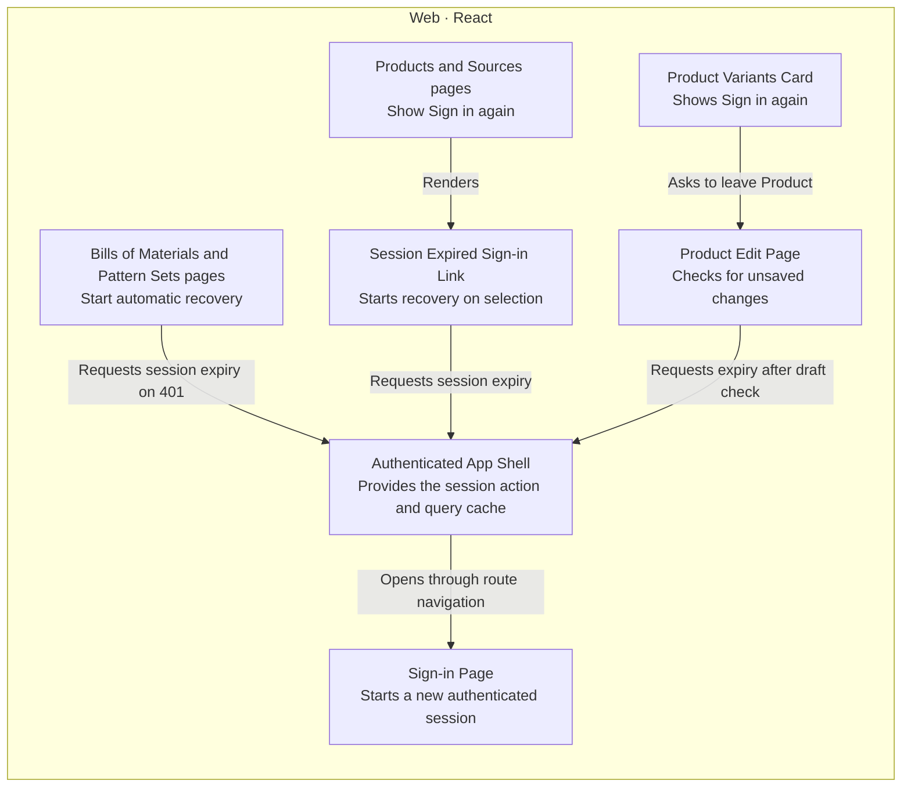
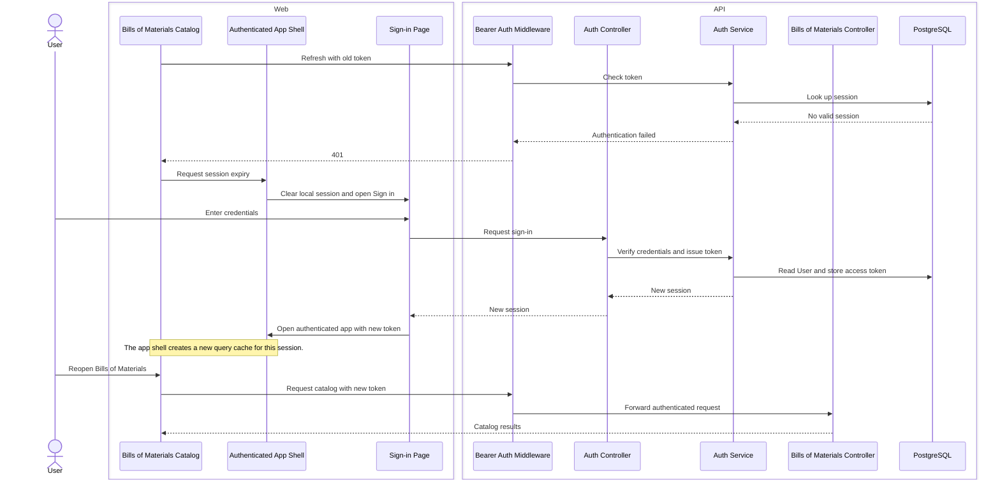

# Catalog sign-in recovery after a 401

Users can sign in again after a catalog session expires and reopen the catalog in the same tab. Products, Sources, Bills of Materials, Pattern Sets, and the Product Variants table use one session-expiration action. The change applies to catalog requests. The separate `/auth/me` verification race is outside Issue 08. [Issue 08](.scratch/table-filter-standard/issues/08-consolidate-catalog-authentication-failure-handling.md)

## One session-expiration action

The authenticated route supplies `expireSession` through the app shell. The action clears the local session and opens **Sign in**. It allows this navigation when local credentials are already absent. It ignores an expiry request if a different token is in storage or a sign-in navigation is already in progress. Sign-out and password change use the same action after the API call succeeds. [Authenticated route](apps/web/src/routes/app.tsx)

| Catalog | Response to a `401` |
| --- | --- |
| Bills of Materials and Pattern Sets | Open **Sign in** automatically. The Product Variant candidate search in Bills of Materials uses the same action. |
| Products and Sources | Show a shared **Sign in again** link. The action starts when the User selects the link. |
| Product Variants | Show a **Sign in again** button in the embedded table. The parent Product page checks for unsaved changes before it calls the action. |

See the [automatic recovery hook](apps/web/src/features/app-shell/authenticated-app-shell.tsx), [shared link](apps/web/src/components/app/session-expired-sign-in-link.tsx), and [parent Product page](apps/web/src/features/products/product-edit-page.tsx).

## Query cache for each authenticated session

The authenticated route keys the session component by token. The app shell creates a TanStack Query client for that component with the app's default query options. The client stays in use as the User moves between authenticated pages in the same session. A new session gets a new client. Cached errors and late responses from the previous session stay with the previous client. This replaces the Pattern Sets cache removal that ran before sign-in. [Authenticated app shell](apps/web/src/features/app-shell/authenticated-app-shell.tsx) · [Pattern Set queries](apps/web/src/features/pattern-sets/api/queries.ts)

## Permission recovery after a 403

The catalog keeps the current session on a `403`. **Clear all** returns to the default catalog query. In the Product Variants table, this action restores the default rows and leaves the parent Product page usable. [Table Filter Standard](docs/ui/table-filters.md#authorization-and-errors) · [Product Variants table](apps/web/src/features/products/components/product-variants-card.tsx)

## Architecture Views

### C4 Level 3 — Web

### C4 Dynamic — Reopen Bills of Materials after session expiry

## Focused Coverage

- A Bills of Materials refresh returns `401` after the table has loaded. The User signs in again and reopens the catalog with the new session. A separate test releases a delayed `401` from the old session after the User signs in again. [Bills of Materials route tests](apps/web/src/routes/-bills-of-materials.test.tsx)
- The Products **Sign in again** link works when local credentials are present or already absent. [Products route tests](apps/web/src/routes/-products.test.tsx)
- A Product Variant `401` respects the Product draft confirmation. A `403` can be cleared without closing the session or losing the draft. [Product Variant route tests](apps/web/src/routes/-product-variants.test.tsx)

## Focused Verification

- The Issue 08 implementation run passed 155 tests across 10 web suites. Web type checking, lint on the changed files, and both independent reviews passed. Vitest reported React `act(...)` and router warnings. [Issue 08 verification](.scratch/table-filter-standard/issues/08-consolidate-catalog-authentication-failure-handling.md#verification)
- A browser check with an isolated API fixture verified the five `401` interactions, sign-in and reopening of Bills of Materials in the same tab, and **Clear all** after a `403` on all five tables. [Browser scenarios](.scratch/table-filter-standard/issues/08-consolidate-catalog-authentication-failure-handling.md#verification)
- A handoff rerun on the current diff passed four focused sign-in and permission tests across the Products, Sources, and Product Variants route suites.

## Scope Boundaries

- The API and its authorization rules stay the same. Catalogs still own their filters, queries, and default results.
- The `/auth/me` bootstrap stays as it was. An overlapping session check can still interfere with a newer sign-in. Issue 08 covers cached and late catalog responses.
- The full `pnpm quality` gate is reserved for the human and CI.
